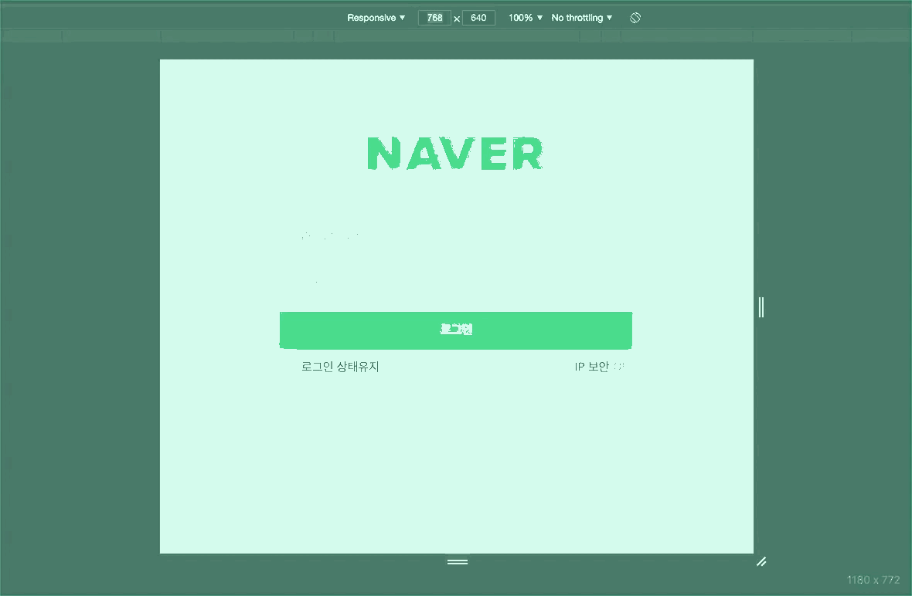

# 네이버 로그인 페이지 구현 과제

이미 완성된 마크업(HTML)과 스타일(CSS) 위에, **JavaScript 로그인 로직**을 직접 작성하는 과제입니다.

아이디와 비밀번호를 올바르게 입력했을 때 `welcome.html` 페이지로 넘어가도록 만드는 것이 최종 목표입니다.

---

## 🎯 학습 목표

- [ ] 재사용 가능한 **함수를 분리**하고, **함수 중심으로 설계**하는 방법을 익힙니다.
- [ ] 정규표현식(RegExp)을 이용한 **유효성 검사(validation)** 를 구현합니다.
- [ ] **상태 변수**로 폼의 통과 여부를 관리합니다.
- [ ] DOM 조작으로 **에러 UI**를 제어합니다. (`classList`)
- [ ] 이벤트 핸들러 안에서의 **`this` 바인딩**을 이해합니다.
- [ ] **고차 함수(Higher-Order Function)** 로 `debounce`를 직접 구현합니다.
- [ ] `try / catch / throw`로 **예외 처리** 흐름을 작성합니다.

---

## 🚀 시작하기

```bash
# 1. 저장소를 받습니다
git clone <이 저장소 주소>
cd naver_login

# 2. VS Code로 엽니다
code .

# 3. Live Server 확장으로 index.html 을 실행합니다
```

> 📌 `file://` 로 직접 열어도 동작하지만, **Live Server** 사용을 권장합니다.

---

## 📁 제공되는 것 / 만들어야 하는 것

| 파일 | 상태 | 설명 |
|------|------|------|
| `index.html` | ✅ 제공 | 로그인 폼 마크업 (수정 거의 불필요) |
| `welcome.html` | ✅ 제공 | 로그인 성공 시 이동할 페이지 |
| `css/style.css` | ✅ 제공 | 반응형 · 에러 UI · 커스텀 체크박스 스타일 |
| `css/fonts.css`, `fonts/`, `images/` | ✅ 제공 | 웹폰트 및 이미지 리소스 |
| **`js/main.js`** | ⚠️ **직접 작성** | **이 파일만 완성하면 됩니다** |

현재 `js/main.js`에는 **데모 계정 객체**와 **정규표현식 함수 2개**만 들어 있습니다.
나머지 로직을 아래 요구사항에 맞춰 채워 넣으세요.

### 데모 계정

```js
const user = {
  id: 'asd@naver.com',
  pw: 'spdlqj123!@'
}
```

---

## ✅ 요구사항

### 1. DOM 요소 가져오기

`document.querySelector()`를 사용해 아래 3개 요소를 변수에 담습니다.

| 대상 | 선택자 힌트 |
|------|------------|
| 아이디 입력창 | `#userEmail` |
| 비밀번호 입력창 | `#userPassword` |
| 로그인 버튼 | `.btn-login` |

---

### 2. 유효성 검사 함수 활용

이미 제공된 두 함수를 **그대로 사용**합니다. (직접 호출만 하면 됩니다)

| 함수 | 통과 조건 |
|------|----------|
| `emailReg(text)` | `@` 기호 포함, `.` 뒤에 2글자 이상 → 이메일 형식 |
| `pwReg(text)` | **6~16자**, 영문 1자 이상 + 숫자 1자 이상 + 특수문자(`!@#$%^*+=-`) 1자 이상 |

> ⚠️ `index.html`의 에러 메시지 문구와 실제 검사 규칙이 일치하는지 확인하고,
> 다르다면 **문구를 규칙에 맞게 수정**하세요.

---

### 3. 실시간 유효성 검사 + 에러 UI

사용자가 입력하는 **동안(`input` 이벤트)** 검사하고, 결과에 따라 에러 UI를 켜고 끕니다.

- **검사 실패** → 입력창에 `is--invalid` 클래스를 **추가**
- **검사 통과** → `is--invalid` 클래스를 **제거**

CSS에 이미 아래 규칙이 들어 있으므로, 클래스만 붙였다 떼면 에러 메시지가 자동으로 나타납니다.

```css
.error-message   { display: none; }
.is--invalid + .error-message { display: block; }
```



> 💡 **핵심 힌트** — 핸들러 안에서 입력값을 `this.value`로 꺼내 쓰려면
> 핸들러를 **화살표 함수가 아닌 일반 함수**로 선언해야 합니다.

---

### 4. 상태 변수로 통과 여부 관리

- 아이디 / 비밀번호 각각의 통과 여부를 담을 **상태 변수**를 선언합니다. (초기값 `false`)
- 3번의 검사 결과에 따라 이 값을 **갱신**합니다.
- 로그인 버튼을 눌렀을 때 **두 값이 모두 `true`일 때만** 로그인 절차를 진행합니다.

---

### 5. 로그인 처리

로그인 버튼 클릭 시 아래 순서대로 동작해야 합니다.

1. 폼이 제출되어 새로고침되지 않도록 **기본 동작을 막습니다.** (`e.preventDefault()`)
2. 상태 변수 두 개가 모두 `true`인지 확인합니다.
3. 입력값과 `user` 객체의 `id` / `pw`를 비교합니다.
4. **일치하면** → `welcome.html` 페이지로 이동시킵니다.
5. **일치하지 않으면** → `throw`로 에러를 발생시키고, `catch`에서
   `alert('아이디 또는 비밀번호가 일치하지 않습니다.')` 를 띄웁니다.

> 💡 3~5번은 반드시 **`try / catch / throw` 구조**로 작성하세요.
> (실제 서비스에서 서버 응답 실패를 처리하는 흐름을 연습하는 부분입니다.)

---

### 6. `debounce` 직접 구현 (⭐ 핵심)

아이디 입력은 글자를 칠 때마다 검사하면 너무 자주 실행됩니다.
**입력이 멈춘 뒤 일정 시간이 지나야** 검사가 실행되도록 `debounce` 함수를 직접 만드세요.

```js
function debounce(callback, limit = 500) {
  // 여기를 구현하세요
}
```

**요구 조건**

- `debounce`는 **함수를 반환**하는 고차 함수입니다.
- 반환된 함수가 호출될 때마다 이전 타이머를 **취소**(`clearTimeout`)하고 새 타이머를 겁니다.
- 지정한 시간(`limit`)이 지나면 원래 콜백을 실행합니다.
- ⚠️ 콜백 안에서 **`this`가 유지**되어야 합니다. (3번 힌트와 연결됩니다 — `call` / `apply` 활용)

**적용 결과**

| 입력창 | 적용 |
|--------|------|
| 아이디 | `debounce` 적용 (1000ms 권장) |
| 비밀번호 | `debounce` 미적용 (즉시 검사) |

---

### 7. 이벤트 연결

| 대상 | 이벤트 | 연결할 핸들러 |
|------|--------|--------------|
| 아이디 입력창 | `input` | `debounce(아이디 검사 핸들러, 1000)` |
| 비밀번호 입력창 | `input` | 비밀번호 검사 핸들러 |
| 로그인 버튼 | `click` | 로그인 처리 핸들러 |

---

## 🧪 테스트 시나리오

아래 경우를 **모두** 직접 테스트하고 통과하는지 확인하세요.

| # | 아이디 | 비밀번호 | 기대 결과 |
|---|--------|----------|-----------|
| 1 | `asdnaver.com` | - | 아이디 에러 메시지 표시 |
| 2 | `asd@naver.com` | `1234` | 비밀번호 에러 메시지 표시 |
| 3 | `asd@naver.com` | `abcdef123!` | 에러 메시지 모두 사라짐 |
| 4 | `asd@naver.com` | `abcdef123!` → 로그인 클릭 | `alert` 로 불일치 안내 |
| 5 | `test@test.com` | `spdlqj123!@` → 로그인 클릭 | `alert` 로 불일치 안내 |
| 6 | `asd@naver.com` | `spdlqj123!@` → 로그인 클릭 | **`welcome.html` 로 이동** |
| 7 | 빈칸 상태로 로그인 클릭 | - | 페이지가 새로고침되지 않음 |
| 8 | 아이디를 빠르게 타이핑 | - | 입력을 멈춘 뒤에야 검사 실행 (debounce) |

---

## 📋 제출 전 체크리스트

- [ ] `js/main.js` 외의 파일은 (요구된 수정 외에) 건드리지 않았다
- [ ] DOM 요소를 변수로 분리했다
- [ ] 아이디 / 비밀번호 상태 변수를 선언하고 갱신한다
- [ ] 검사 실패 시 `is--invalid` 클래스가 붙고, 성공 시 제거된다
- [ ] 로그인 클릭 시 `e.preventDefault()`로 새로고침을 막는다
- [ ] 로그인 실패는 `try / catch / throw` 로 처리했다
- [ ] 로그인 성공 시 `welcome.html` 로 이동한다
- [ ] `debounce`를 직접 구현했고, `this`가 정상 동작한다
- [ ] 콘솔에 에러가 하나도 없다
- [ ] 디버깅용 `console.log`를 정리했다

---

## 📊 평가 기준

| 항목 | 배점 |
|------|-----:|
| 유효성 검사 + 에러 UI 동작 | 25 |
| 상태 변수 관리 | 15 |
| 로그인 분기 및 페이지 이동 | 20 |
| `try / catch / throw` 예외 처리 | 15 |
| `debounce` 구현 (`this` 유지 포함) | 15 |
| 함수 분리 · 네이밍 · 코드 가독성 | 10 |
| **합계** | **100** |

---

## 💡 자주 하는 실수

<details>
<summary><b>1. 화살표 함수를 핸들러로 썼더니 <code>this.value</code>가 undefined 입니다</b></summary>

화살표 함수는 자신만의 `this`를 갖지 않습니다. 이벤트 핸들러에서 `this`로 요소에 접근하려면
**일반 함수 선언(`function`)** 을 사용하세요. (또는 `e.target`을 사용해도 됩니다.)
</details>

<details>
<summary><b>2. debounce를 적용했더니 <code>this</code>가 깨집니다</b></summary>

`setTimeout` 안에서 콜백을 그냥 `callback(e)`로 부르면 `this`가 사라집니다.
바깥 함수의 `this`를 `call` / `apply`로 **명시적으로 넘겨주세요.**
</details>

<details>
<summary><b>3. 로그인 버튼을 누르면 페이지가 새로고침됩니다</b></summary>

버튼이 `type="submit"`이라 폼이 제출됩니다. 핸들러 첫 줄에서 `e.preventDefault()`를 호출하세요.
</details>

<details>
<summary><b>4. 에러 메시지가 안 보입니다</b></summary>

`is--invalid` 클래스는 **`<input>` 요소 자신**에 붙어야 합니다.
CSS가 `.is--invalid + .error-message` (인접 형제 선택자)로 되어 있기 때문입니다.
</details>

---

## 🔥 심화 과제 (선택)

- [ ] `index.html`이 링크하고 있는 `ip_security.html` 페이지를 직접 만들어 보세요. (`images/ip-security.png` 참고)
- [ ] `alert` 대신 화면 안에 노출되는 에러 메시지 UI로 교체해 보세요.
- [ ] '로그인 상태 유지' 체크 시 `localStorage`에 아이디를 저장하고, 다음 방문에 자동 입력되게 만들어 보세요.
- [ ] 로그인 버튼을 **두 검사가 모두 통과했을 때만 활성화**되도록 바꿔 보세요. (`disabled` 속성)
- [ ] 서버 통신을 흉내 내도록 로그인 처리를 `Promise` + `async / await` 로 바꿔 보세요.

---

## 📤 제출 방법

```bash
git add .
git commit -m "feat: 로그인 유효성 검사 및 로그인 로직 구현"
git push origin main
```

푸시한 저장소 주소를 제출해 주세요.
